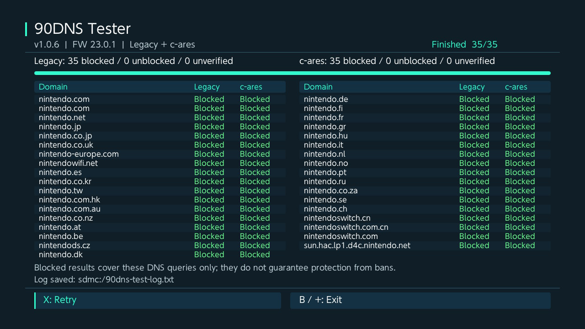

# 90DNS Tester

A standalone Nintendo Switch DNS blocking tester with a HATS-style graphical interface. View all 35 domain entries on one screen and compare Legacy and c-ares results side by side.



Based on [Switch 90DNS Tester](https://github.com/meganukebmp/Switch_90DNS_tester), originally authored by **Nexrem** and maintained by its contributors. This fork by **STHETIX** adds the graphical interface and c-ares testing; it is not an upstream release.

A blocked result confirms the returned addresses for that query; it does not verify every application's traffic or guarantee protection from bans.

## Features

- Tests Nintendo domains using Legacy (`gethostbyname`) and c-ares (FW 23 Query + Fetch, `sfdnsres` commands 100/102).
- Displays all domain entries in two tables, with progress, summaries, and controller/touch controls.
- Shows separate Legacy and c-ares columns, with green blocked, red unblocked, and yellow inconclusive results.
- Checks every returned address: IPv4 `127.0.0.1`/`0.0.0.0` and c-ares IPv6 `::1`/`::` count as blocked.
- Shows an end-of-run summary; unknown results are never counted as blocked.
- On older firmware, c-ares displays N/A.
- Appends results and IPC diagnostics to `sdmc:/90dns-test-log.txt`.

## Using 90DNS Tester

Extract the ZIP to the SD card and launch `/switch/Switch_90DNS_tester/Switch_90DNS_tester.nro` from the Homebrew Menu. Tests start automatically in a worker thread with a standalone GUI using a HATS-style dark theme. All domains are visible in two side-by-side tables without scrolling. Use X to retry after completion, and B or + to exit. Retry and Exit also accept touch input. Exit during a run waits for the current resolver call to return before closing services; legacy calls do not have a new timeout imposed by the GUI.

The screen shows separate Legacy and c-ares results, progress, blocked counts, separate unblocked/unverified counts, and log write status. Pending queries are not counted as unverified. No firmware installation functionality or `ams:su` service is included.

| Status | Meaning |
| --- | --- |
| blocked | All returned addresses match the blocking addresses above. |
| unblocked | At least one returned address is outside those addresses. |
| timeout | No completion event within 2 seconds, or the resolver reported a DNS timeout. Blocking is unverified; the TXT log distinguishes event timeout from resolver timeout. |
| unresolved | The resolver did not return a successful address result. |
| offline | No current network IP was available. |
| error | IPC, event handling, or result parsing failed. |
| pending | Query has not completed yet; not counted as blocked or unverified. |
| N/A | c-ares requires firmware 23.0.0 or newer. |

The log records console time, firmware, EventFd, Query, Poll, EventRead, Fetch when ready, and Cancel. The c-ares event wait is limited to 2 seconds per domain; this is not a total runtime limit. Legacy DNS calls and other IPC calls may take additional time.

## Building

Requires [devkitPro](https://devkitpro.org/) with libnx, deko3d, GLM headers, and the `uam` shader compiler installed. The bundled NanoVG renderer is compiled from source, and its shaders are compiled into RomFS by the Makefile.

```bash
make
```

`make` builds `Switch_90DNS_tester.nro` and creates `Switch_90DNS_tester-1.0.6.zip` containing `switch/Switch_90DNS_tester/Switch_90DNS_tester.nro`, ready to extract to the SD card. The name stays fixed when Docker mounts the project at `/work`. Use the existing devkitPro PowerShell/Docker wrapper or a configured devkitPro shell.

## Credits

Based on [Switch 90DNS Tester](https://github.com/meganukebmp/Switch_90DNS_tester), originally authored by Nexrem and maintained by its contributors. Local modifications are maintained by STHETIX. The application icon uses the HATS-style dark and mint palette. The previous icon is preserved in `assets/appicon-original.jpg`, and the new master image is in `assets/appicon.png`.

The FW 23 IPC layout and serialization were checked against [Atmosphere's DNS MITM implementation](https://github.com/Atmosphere-NX/Atmosphere/commit/f5cd912604c342faf884e776b1aaaa5f9b3b5e98).

The renderer is the NanoVG/deko3d implementation bundled with Daybreak, by Adubbz, Mikko Mononen, and fincs. Its original license notices are retained under `nanovg/`. The tester UI is implemented separately; Daybreak firmware-update UI code is not included.

## License

LGPL-3.0. See [COPYING](COPYING).

## Support My Work

If you find this project useful, please consider supporting me by buying me a coffee!

<a href="https://www.buymeacoffee.com/sthetixofficial" target="_blank">
  
</a>
